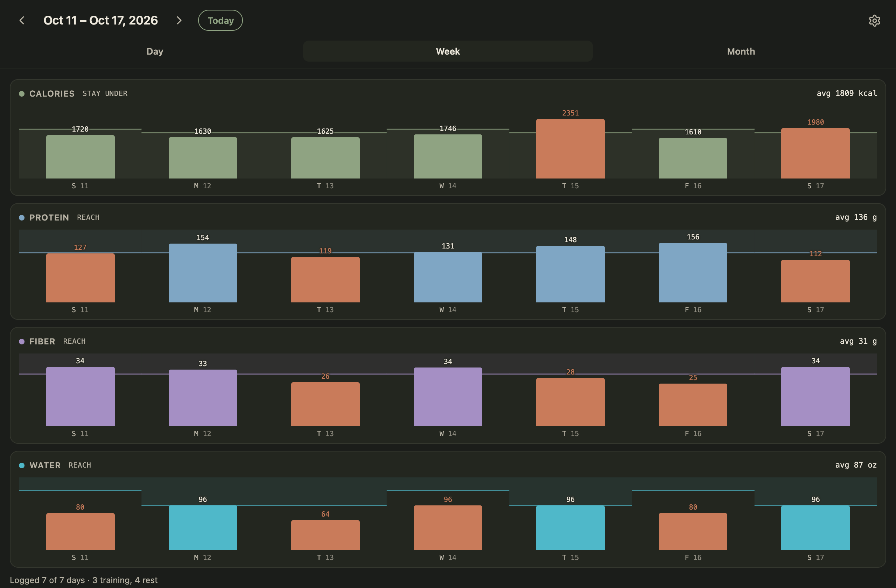

# Cairn

A daily log that runs on your own machine: what you ate, drank, weighed and
did, with the numbers worked out for you. It is a web app you add to your
phone's home screen, served from a desktop over your own network and backed
by one SQLite file. No accounts, no cloud.

## What it looks like

<table>
  <tr>
    <td width="33%"></td>
    <td width="33%"></td>
    <td width="33%"></td>
  </tr>
  <tr>
    <td><b>A day.</b> Calories and macros against the day's goals, then water, alcohol, workouts and the rest, each a card.</td>
    <td><b>Meals.</b> The scale's latest readings, then every food logged, with its macros, grouped by meal.</td>
    <td><b>Adding food.</b> Your saved foods for one tap, a search of the USDA and Open Food Facts databases, or type it in.</td>
  </tr>
  <tr>
    <td></td>
    <td></td>
    <td></td>
  </tr>
  <tr>
    <td><b>A week.</b> Each day against its own goal, since training days get more carbs and water, with notes written by a local model.</td>
    <td><b>A month.</b> The same numbers as a line; tap a day to see it, tap again to open it.</td>
    <td><b>Goals.</b> Protein, fat, carbs and fiber per day, what a training day adds, water, and the weekly alcohol cap.</td>
  </tr>
</table>

<p></p>

The screenshots use demo data. To regenerate them:

```bash
npm run seed:demo && npm run dev   # one terminal
npm run screenshots                # another; needs Google Chrome
```

## What it tracks

- **Meals and macros.** Calories, protein, carbs, fat and fiber per entry, with daily targets and a day, week and month view.
- **Food lookup**, three ways. Search the USDA FoodData Central and Open Food Facts databases. Scan a nutrition label from a photo, which a local vision model reads. Or ask for an online lookup, where a local model with a web-research tool reads the restaurant's or brand's own page.
- **My foods.** Anything you have typed or confirmed, for one-tap logging. Saved meals log several at once.
- **Water, alcohol, workouts, dog walks and meditation**, each its own tracker.
- **Body.** Weight and composition, from Apple Health or a Withings import.
- **Notes.** Two or three short paragraphs on a week or a month, written from your own numbers against your goals.

Every lookup and scan produces candidates for you to check. Nothing a model
read or saw is logged on its own.

## Run

```bash
npm install
npm run dev          # http://localhost:8200, scratch database in .data-dev/
npm run check        # typecheck + lint + tests
npm run build
npm run preview      # the persistent instance on :8210, data in .data/
npm run seed:demo    # fill the dev database with two weeks of demo data
npm run screenshots  # regenerate docs/screenshots/ from the dev server
```

Nothing is required for plain food search and manual logging. Settings
holds an optional USDA API key (the free `DEMO_KEY` works but is rate
limited) and the LM Studio address and token the model features use.

### Keeping it running

`npm run deploy` rebuilds and restarts a launchd job named
`com.amie.cairn` that runs `vite preview`. Create that job once with a plist
that runs `npm run preview` from this directory with `KeepAlive` on. To
reach it from a phone, put :8210 behind Tailscale Serve and open the
`.ts.net` address.

### Withings, optional

`node scripts/withings.mjs auth` signs in once and stores tokens outside the
repo, in `~/.config/cairn/withings.json`. `probe` lists the measurements
your account returns. Put your Withings client id and secret in that file
first.

## Local models

Three things in Cairn use a model, all through [LM Studio](https://lmstudio.ai)
on this machine. Nothing leaves your network, and none of it is needed for
logging by hand.

**Start LM Studio's server** in its Developer tab. The default address,
`http://127.0.0.1:1234`, is what Settings starts with. If Require
Authentication is on, create a token under Manage Tokens and paste it into
Settings. It stays on the server. Authentication is required for the online
lookup, which uses an MCP tool.

- **Online lookup** (the *Model* field) runs a chat model with the
  `deep-research` MCP server, so it can read a restaurant's or brand's own
  nutrition page. Install
  [minimal-mcp-deep-research](https://github.com/akuttruff/minimal-mcp-deep-research),
  add it to `~/.lmstudio/mcp.json` as `deep-research`, and enable *Allow
  calling servers from mcp.json* in LM Studio's Developer settings. Good
  tool calling matters more than size here. `qwen/qwen3.8-27b` is what this
  is tested with.
- **Label scanning** (the *Label model* field) needs a model that can see
  images, and Settings lists only those. A photo of a label is downscaled
  and sent as the only input, and the numbers come back into the Manual tab
  for you to check.
- **Week and month notes** (the *Notes model* field) suit a small model, say
  `qwen/qwen3.5-9b`. Leave the field blank to use the lookup model.

Cairn talks to LM Studio's `/api/v1/chat` endpoint, so it needs LM Studio
0.4 or newer.

## Stack and layout

Vite + React 19 + TypeScript, with the API as a Vite plugin so one process
serves both. Data lives in `.data/` as SQLite (`node:sqlite`, Node 24+).
Tests run under vitest; lint is oxlint.

```
server/   api.ts (routes), store.ts (SQLite), foods.ts (USDA + Open Food Facts),
          label.ts (vision model), research.ts (online lookup), notes.ts
src/      App.tsx, components/ (trackers, sheets, the Add flow in add/), lib/
scripts/  deploy.sh, withings.mjs, seed-demo.ts, screenshots.mjs
docs/     screenshots/ for this README
```
