# 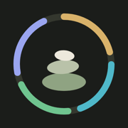 Cairn

A daily log and training planner that runs on your own machine. **Nutrition**
tracks what you eat and drink against your goals. **Train** follows a
multi-week training plan set by set, and a coach you can talk to (a local
model) answers questions and changes the plan when you ask. It is a web app
you add to your phone's home screen, served from a desktop over your own
network and backed by one SQLite file. No accounts, no cloud.

## What it looks like

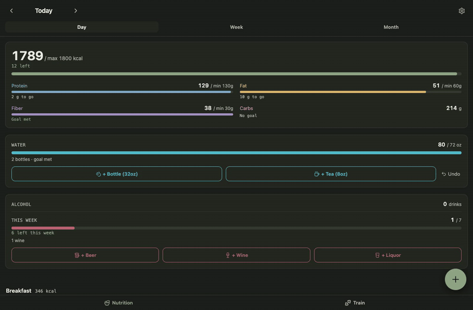

<p>On a desktop: a food is searched for, picked and logged, the day takes it in, then the week and the month. Then Train: today's sessions, a set ticked off, and the coach.</p>

<p align="center">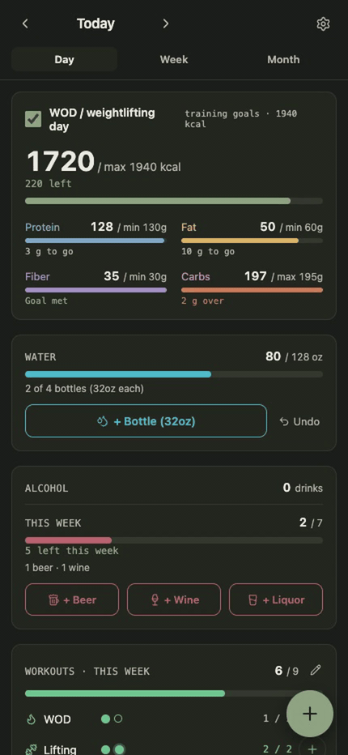</p>

<p align="center">The same flow on a phone.</p>

<table>
  <tr>
    <td align="center" valign="top" width="33%">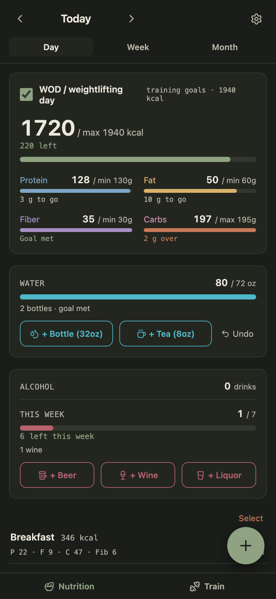<br /><b>Day</b><br /><sub>Calories and macros against your goals</sub></td>
    <td align="center" valign="top" width="33%">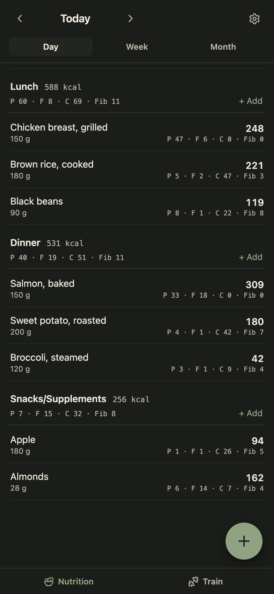<br /><b>Meals</b><br /><sub>Every food with its macros; tap to edit</sub></td>
    <td align="center" valign="top" width="33%">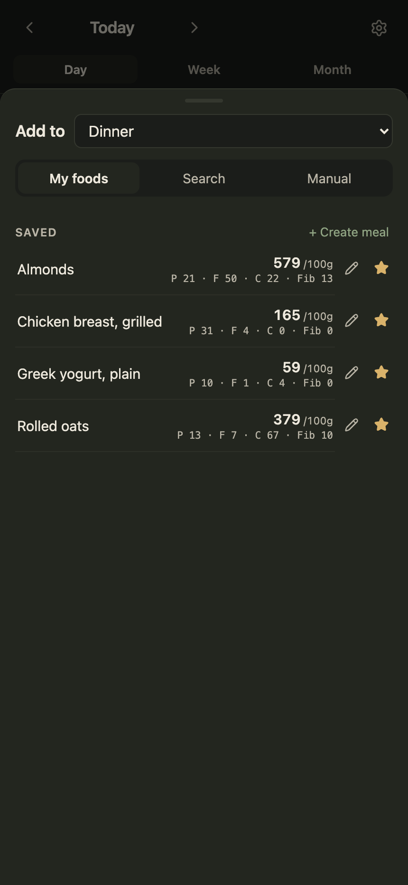<br /><b>Add</b><br /><sub>Saved foods, a database search, or type it in</sub></td>
  </tr>
  <tr>
    <td align="center" valign="top" width="33%">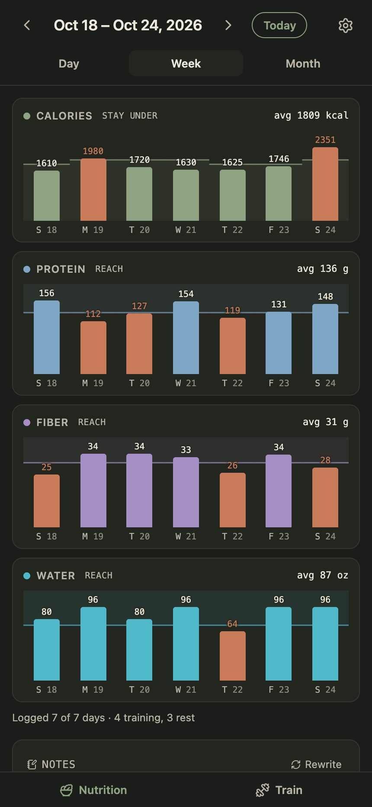<br /><b>Week</b><br /><sub>Each day against its own goal, with notes</sub></td>
    <td align="center" valign="top" width="33%">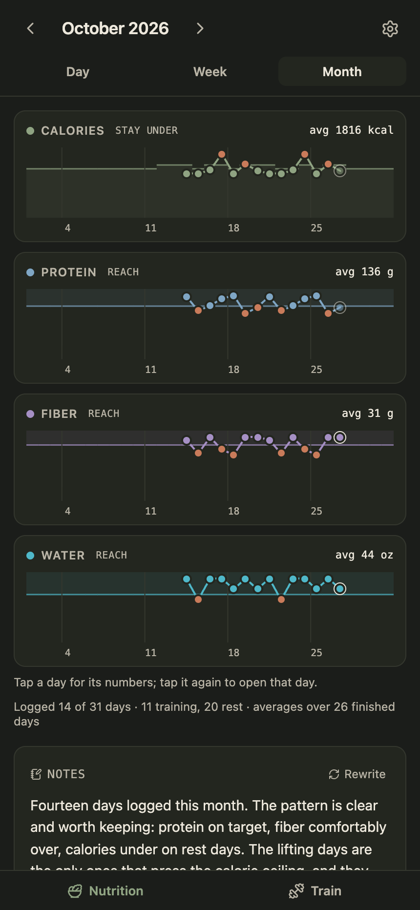<br /><b>Month</b><br /><sub>The same numbers as a line</sub></td>
    <td align="center" valign="top" width="33%">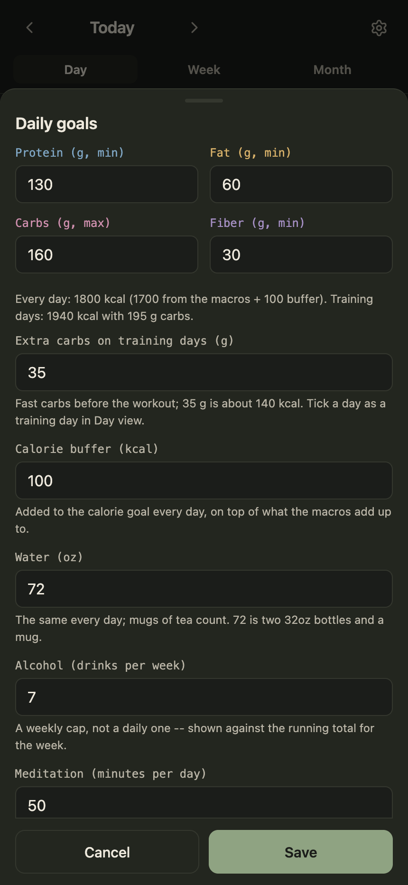<br /><b>Goals</b><br /><sub>Macros per day, and what a training day adds</sub></td>
  </tr>
  <tr>
    <td align="center" valign="top" width="33%">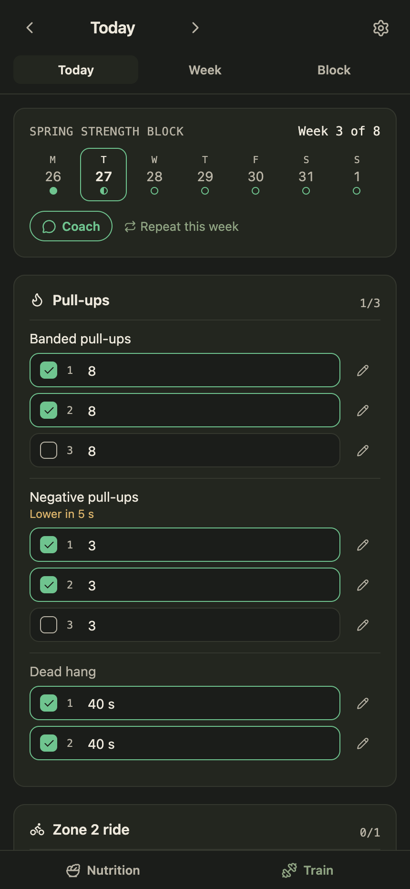<br /><b>Train</b><br /><sub>Today's sessions set by set, weights from your PRs</sub></td>
    <td align="center" valign="top" width="33%">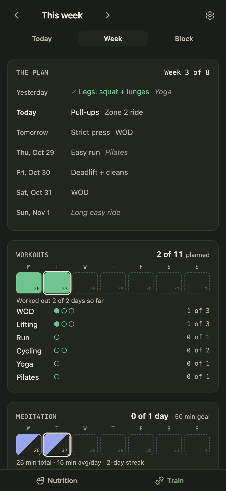<br /><b>Week</b><br /><sub>The week's plan, and what got done</sub></td>
    <td align="center" valign="top" width="33%">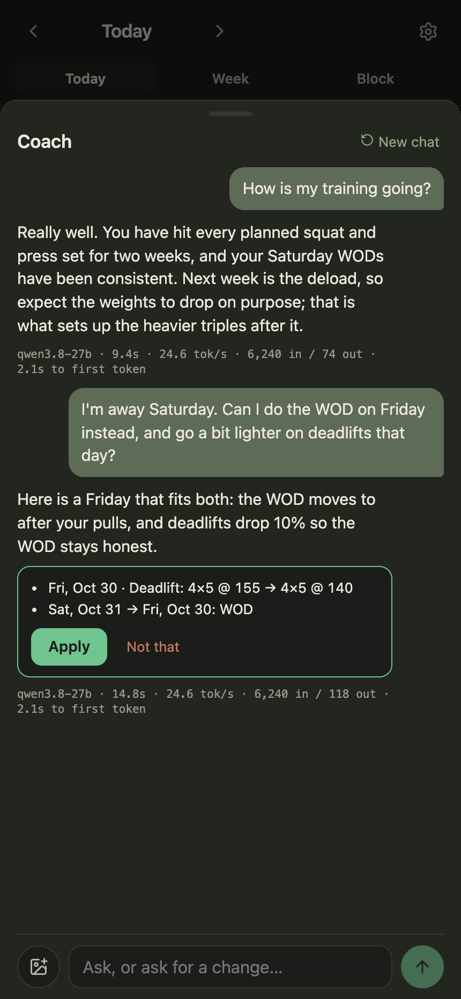<br /><b>Coach</b><br /><sub>Ask, get feedback, or change the plan</sub></td>
  </tr>
</table>

The screenshots use demo data, a made-up plan included. To regenerate them:

```bash
npm run seed:demo && npm run dev   # one terminal
npm run screenshots                # another; needs Google Chrome
```

## What it does

The app has two sections, along the bottom: Nutrition, which it opens on, and Train. They share one date, so switching keeps the same day in view.

### Nutrition

- **Meals** log calories, protein, carbs, fat and fiber per entry, against daily targets, in a day, week and month view.
- **Food lookup** works three ways. Search the USDA FoodData Central and Open Food Facts databases, scan a nutrition label from a photo for a local vision model to read, or ask for an online lookup, where a local model with a web-research tool reads the restaurant's or brand's own page.
- **Label scanning** turns a picture into a food. Upload a photo or screenshot of a nutrition label, paste one, or drop it anywhere on the page. A local vision model reads it and fills in the Manual tab: name, brand, serving and macros. The food is ticked to save to My foods, so it is there for next time once you have checked it.
- **My foods** keeps anything you have typed or confirmed, for one-tap logging, and saved meals log several at once.
- **Water and tea** count toward one daily water goal; **alcohol** is tracked against a weekly cap.
- **Notes** are two or three short paragraphs on a week or a month, written from your own numbers against your goals.

### Train

- **A training plan** you follow day by day. Each session is laid out set by set, with weights worked out from your PRs and rounded to each lift's plates. Tap a set to tick it off at the planned numbers, or note what you actually lifted. Deload and test weeks, a PR-attempt ladder, and "repeat this week" are built in.
- **PRs and progress.** Set a new PR and every weight in the plan follows. Charts show your top sets, estimated maxes, and baselines like dead hang time.
- **A WOD bank** of about 40 workouts, offered three at a time to fit the day's slot and the equipment you have. A barbell becomes dumbbells and a jump rope becomes bike calories, and dumbbell weights match the pairs you own.
- **A coach** you talk to. Ask how your training is going or what it thinks of the plan, or ask for a change: move a day, skip one, go lighter for a sore joint, travel with less gear, make yoga optional, or untick something logged by mistake. You can send a screenshot to show what you mean. Every change comes back as a card spelling out exactly what it would do. Nothing changes until you apply it, and anything applied can be undone. It can also correct past days, or rewrite the rest of the plan.
- **The next block**, written by your local model from how this one went, set by set, and reviewed before it's followed.
- **Workouts, meditation and dog walks** each have their own tracker, with week summaries.

Plans are written as [training schemas](docs/training-schema.md), a documented JSON shape you can import (`npm run import:schema`).

Every lookup, scan and coach change produces something for you to check. Nothing a model
read, saw or suggested is logged or applied on its own.

## Before you start

### How it fits together

```
your phone or desktop browser
        │  http, over your own network
        ▼
Cairn ── one Node process on one computer ── .data/cairn.sqlite
        │
        ├──▶ a model server on the same computer   (label scanning, online lookups, notes, the coach, training plans)
        └──▶ USDA and Open Food Facts              (food search, over the internet)
```

Cairn is one Node process that does two jobs: it serves the app to any
browser on your network, and it keeps your log in a single SQLite file on
that computer. Your phone talks only to Cairn. For the model features, Cairn
talks to a model server running beside it, so no model, token or data ever
reaches the browser. Logging by hand needs nothing but Node.

### What you need

| For | You need |
|---|---|
| Logging food, water, workouts and the rest by hand | Node 24 or newer, on the computer that will keep the data |
| Food search | Internet access. A free [USDA API key](https://fdc.nal.usda.gov/api-key-signup) is optional; the built-in `DEMO_KEY` is rate limited |
| Scanning a nutrition label from a photo | A model server with a model that can see images |
| Looking a restaurant or brand item up online | A model server with a chat model that calls tools well, plus the `deep-research` MCP server (below) |
| Week and month notes | A model server with any chat model; a small one is enough |
| A training plan | Nothing extra: write one as a [training schema](docs/training-schema.md) and import it |
| The coach | A model server with a mid-size chat model (a 27B answers in under a minute); one that can see images, for screenshots |
| Writing the next block, or rewriting a plan | A model server with a capable chat model; a large one plans better, in a few minutes |
| Opening it on your phone | The phone on the same Wi-Fi, or [Tailscale](https://tailscale.com) on both devices (see *Keeping it running*) |

Node 24 is the floor because the log is stored with `node:sqlite`, which
arrived in that version. Check with `node --version`.

### A model server

Cairn sends its requests to a model server's `/api/v1/chat` endpoint, the
API that [LM Studio](https://lmstudio.ai) 0.4 introduced, because it
carries tool calls, images and streamed replies in one request. LM Studio
is the server these steps use. Any other server that implements that same
API works the same way; one that offers only the OpenAI chat API does not,
yet. The server runs on the same computer as Cairn, and nothing leaves your
network.

1. Install the server and download the models you want. In LM Studio that
   is the Discover tab. For label scanning pick a model that can see images
   (LM Studio marks these with a vision badge). For online lookups pick one
   that calls tools well; `qwen/qwen3.8-27b` is what this is tested with.
   For notes, a small model such as `qwen/qwen3.5-9b` is enough.
2. Start the server. In LM Studio that is the **Developer** tab. Its
   default address, `http://127.0.0.1:1234`, is what Cairn's Settings start
   with; change it there if your server listens elsewhere.
3. If the server asks for a token (in LM Studio, **Require Authentication**
   under **Manage Tokens**), paste it into Cairn's Settings. It is kept on
   the server and never sent to the browser. LM Studio requires
   authentication for the online lookup, which uses an MCP tool.
4. In Cairn's Settings, pick the model for each feature: *Model* for the
   online lookup, *Label model* for scanning, *Notes model* for the notes,
   *Coach model* for the coach, and *Training model* for writing training
   plans. The notes, coach and training models fall back to the lookup model
   when blank. A model that can't be told not to think needs more time per
   reply, so pick one that can for the coach.

**The online lookup's tool.** The lookup gives the model a web-research
tool so it can read a restaurant's or brand's own nutrition page. Install
[minimal-mcp-deep-research](https://github.com/akuttruff/minimal-mcp-deep-research)
and register it with your model server under the name `deep-research`. In
LM Studio that means an entry in `~/.lmstudio/mcp.json` and **Allow calling
servers from mcp.json** in the Developer settings.

## Run

```bash
npm install
npm run dev          # http://localhost:8200, scratch database in .data-dev/
npm run check        # typecheck + lint + tests
npm run build
npm run preview      # the persistent instance on :8210, data in .data/
npm run seed:demo    # fill the dev database with two weeks of demo data and a made-up plan
npm run screenshots  # regenerate docs/screenshots/ from the dev server
npm run import:schema -- plan.json   # load a training plan (add --dir .data-dev for the dev database)
```

On your phone, open the **Network** address that Vite prints (for example
`http://192.168.1.50:8200/`) and add it to the home screen.

### Keeping it running

`npm run deploy` rebuilds and restarts a launchd job named
`com.amie.cairn` that runs `vite preview`. Create that job once with a plist
that runs `npm run preview` from this directory with `KeepAlive` on. To
reach it from anywhere, put :8210 behind Tailscale Serve and open the
`.ts.net` address:

```bash
/Applications/Tailscale.app/Contents/MacOS/Tailscale serve --bg --https=443 http://127.0.0.1:8210
```

The app is served from the browser's cache on every launch, so it opens at
once on the phone even before the tunnel is up, and says so if the server
cannot be reached.

## Stack and layout

Vite + React 19 + TypeScript, with the API as a Vite plugin so one process
serves both. Data lives in `.data/` as SQLite (`node:sqlite`, Node 24+).
Tests run under vitest; lint is oxlint.

```
server/   api.ts (routes), store.ts (SQLite), foods.ts (USDA + Open Food Facts),
          label.ts (vision model), research.ts (online lookup), notes.ts,
          store/training.ts (plans, sets, PRs, the coach's changes),
          training-chat.ts (the coach), training-gen.ts (writing plans)
src/      App.tsx, components/ (trackers, sheets, the Add flow in add/, Train in train/),
          lib/ (lib/training/: the schema, resolving weeks, the WOD bank)
public/   sw.js, the app shell cache
scripts/  deploy.sh, seed-demo.ts, screenshots.mjs, import-schema.ts
docs/     training-schema.md, screenshots/ for this README
```
